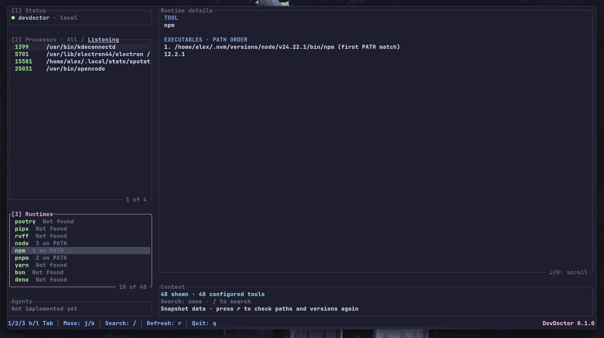

# DevDoctor

[](https://crates.io/crates/devdoctor)

A terminal checkup for your development environment. DevDoctor is a small,
read-only TUI for finding the processes, TCP listeners, and toolchains that are
running or installed on your machine.



## What it shows

- **Processes** — PID, command, working directory, and reported TCP listeners.
  Switch between all processes and only the ones listening on a port.
- **Runtimes** — development tools found on `PATH`, every matching executable in
  `PATH` order, and the version reported by each one.
- **Details** — inspect the selected process or runtime without leaving the
  terminal.

Processes and runtimes can be searched independently. Search is case-insensitive:
processes match against the PID or full command, while runtimes match against the
tool name. Counts and details always reflect the currently visible list.

## Installation

DevDoctor requires a recent stable Rust toolchain.

```sh
cargo install devdoctor
```

Then run:

```sh
devdoctor
```

## Keys

| Key                       | Action                               |
| ------------------------- | ------------------------------------ |
| `1` / `2` / `3`           | Focus Status, Processes, or Runtimes |
| `h` / `l` / `Tab`         | Cycle sections                       |
| `j` / `k`, arrows         | Move the selection                   |
| `g` / `G`, `Home` / `End` | Jump to the first or last item       |
| `PageUp` / `PageDown`     | Move ten items                       |
| `/`                       | Search the focused section           |
| `Enter`                   | Keep the search and stop editing     |
| `Esc`                     | Clear the search and stop editing    |
| `[` / `]` / `f`           | Toggle All / Listening in Processes  |
| `J` / `K`                 | Scroll the Details panel             |
| `r`                       | Refresh the snapshot                 |
| `q`                       | Quit                                 |

## Scope

DevDoctor is read-only by design:

- It never terminates processes.
- Version checks run `--version` for each discovered tool. They have a timeout,
  but they still execute local programs and can be slowed down by broken shims.

## Development

```sh
cargo run
cargo test
cargo clippy --all-targets -- -D warnings
```
